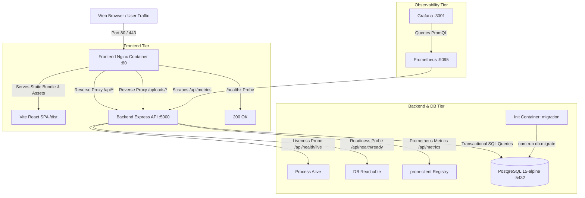

# DevOps Academy - CI/CD & Production Deployment Guide

Comprehensive guide for deploying DevOps Academy to local development and cloud production environments using optimized multi-stage Docker images, Docker Compose, automated database migrations, healthcheck probes, Prometheus observability, and GitHub Actions CI/CD pipelines.

---

## 1. Production Architecture Overview



---

## 2. Deployment Prerequisites

Before running or deploying the stack, ensure the following tools are installed on your host machine or deployment runner:

- **Docker Engine**: Version 24.0.0+
- **Docker Compose**: Version 2.20.0+ (Compose V2 plugin)
- **Node.js**: Version 20.x LTS (for local non-containerized development/testing)
- **npm**: Version 10.x+
- **PostgreSQL**: Version 15+ (if running database locally outside Docker)
- **curl** / **httpie**: For verifying health and metrics endpoints

---

## 3. Environment Variables Reference

DevOps Academy uses environment variables to configure database connections, JWT secrets, ports, and external services.

> [!CAUTION]
> Never commit real `.env` or credential files into version control. Always copy from `.env.example` and supply cryptographically random secrets via your secret manager or CI/CD secrets.

### Backend Variables

| Variable | Description | Default / Example | Required in Prod |
|---|---|---|---|
| `PORT` | API server listening port | `5000` | Yes |
| `NODE_ENV` | Application runtime environment (`development`, `production`, `test`) | `production` | Yes |
| `DB_HOST` | PostgreSQL hostname or Docker service name | `db` (Docker) or `localhost` | Yes |
| `DB_PORT` | PostgreSQL port | `5432` | Yes |
| `DB_NAME` | PostgreSQL database name | `devops_academy` | Yes |
| `DB_USER` | PostgreSQL database user | `devopsuser` | Yes |
| `DB_PASSWORD` | PostgreSQL database password (minimum 8 chars) | *(strong password)* | Yes |
| `JWT_SECRET` | Secret key for signing JSON Web Tokens (min 32 characters) | *(strong random secret)* | Yes |
| `JWT_EXPIRES_IN` | JWT token validity duration | `7d` | No |
| `CLIENT_URL` | Allowed origin URL for CORS | `http://localhost:5200` | Yes |
| `DEFAULT_ADMIN_EMAIL` | Initial admin account email seeded on migration | `admin@devopsacademy.local` | No |
| `DEFAULT_ADMIN_PASSWORD` | Initial admin password (must change on first login) | *(strong password)* | Yes (if seeded) |
| `SMTP_HOST` | Outgoing mail server host | `smtp.gmail.com` | No (mock fallback) |
| `SMTP_PORT` | SMTP port | `587` | No |
| `SMTP_USER` | SMTP username | *(empty)* | No |
| `SMTP_PASS` | SMTP application password | *(empty)* | No |

### Frontend Variables

| Variable | Description | Default / Example | Required in Prod |
|---|---|---|---|
| `VITE_API_URL` | Target API backend URL for client requests | `/api` (via Nginx reverse proxy) or `http://localhost:5000/api` | Yes |
| `FRONTEND_PORT` | Host port mapped to Nginx web server | `5200` (local) or `80` (prod) | No |

---

## 4. Local Development Docker Setup (`docker-compose.yml`)

The standard Compose file spins up the complete stack for local development and verification:
- `db`: PostgreSQL 15-alpine on port 5432
- `backend`: Express API on port 5000
- `frontend`: Nginx serving built SPA and proxying `/api` on port 5200

### Step-by-Step Local Run

```bash
# 1. Clone repository and navigate to root
cd devops-academy

# 2. Copy the sample environment file
cp .env.example .env

# 3. Validate Docker compose configuration
docker compose config

# 4. Build and launch all containers in detached mode
docker compose up -d --build

# 5. Check container statuses and health probes
docker compose ps

# 6. View running logs
docker compose logs -f backend
```

Access Points:
- **Frontend App**: `http://localhost:5200`
- **Backend API**: `http://localhost:5000/api`
- **Health Check**: `http://localhost:5000/api/health`
- **Prometheus Metrics**: `http://localhost:5000/api/metrics`

---

## 5. Production Docker Setup (`docker-compose.prod.yml`)

The production Compose configuration adds an init container for schema migrations, sets strict restart policies, resource limits, and isolates containers across private overlay networks.

| Service | Container Name | Port Mapping | Healthcheck / Probe |
|---|---|---|---|
| **`db`** | `devops_academy_prod_db` | `5432` (internal) | `pg_isready -U devopsuser -d devops_academy` |
| **`migration`** | `devops_academy_prod_migration` | *(none - init)* | Runs `npm run db:migrate` then terminates cleanly |
| **`backend`** | `devops_academy_prod_backend` | `5000:5000` | HTTP GET `/api/health/ready` |
| **`frontend`** | `devops_academy_prod_frontend` | `80:80` | HTTP GET `/healthz` |
| **`prometheus`** | `devops_academy_prod_prometheus` | `9095:9090` | HTTP GET `/-/healthy` (profile: `monitoring`) |
| **`grafana`** | `devops_academy_prod_grafana` | `3001:3000` | HTTP GET `/api/health` (profile: `monitoring`) |

### Production Deployment Commands

```bash
# 1. Prepare production environment file
cp .env.example .env.production
# Edit .env.production with strong, unique secrets and production domain

# 2. Validate environment configuration before deployment
cd backend && npm run env:validate:strict
cd ..

# 3. Validate production compose configuration
docker compose -f docker-compose.prod.yml --env-file .env.production config

# 4. Build production container images
docker compose -f docker-compose.prod.yml --env-file .env.production build

# 5. Launch the core stack (Database + Migrations + Backend + Frontend)
docker compose -f docker-compose.prod.yml --env-file .env.production up -d

# 6. (Optional) Launch with full monitoring stack enabled
docker compose -f docker-compose.prod.yml --env-file .env.production --profile monitoring up -d

# 7. Verify all containers are healthy
docker compose -f docker-compose.prod.yml ps
```

---

## 6. Dockerfile Architecture & Optimization

### Backend Dockerfile (`backend/Dockerfile`)
The backend image is optimized for production reliability, minimal attack surface, and security:
- **Multi-Stage Build**: Separates dependency installation (`deps` stage) from execution (`runner` stage).
- **Alpine Base**: Built on `node:20-alpine`, keeping final image size under 150MB.
- **Tini Init System**: Uses `/sbin/tini` as PID 1 to ensure instant and clean signal forwarding (`SIGTERM`/`SIGINT`) and zombie process reaping.
- **Least-Privilege Security**: Runs as non-root user `devopsuser` (UID: 1001, GID: 1001).
- **Readiness Health Probe**: Uses built-in Docker `HEALTHCHECK` targeting `/api/health/ready` to ensure database connectivity before accepting incoming traffic.
- **Dependency Caching**: Strips dev dependencies (`npm ci --omit=dev --ignore-scripts`) and cleans npm cache.

### Frontend Dockerfile (`frontend/Dockerfile`)
- **Stage 1 (Builder)**: Builds static assets using Vite + TypeScript with tree-shaking and minification.
- **Stage 2 (Runner)**: Serves static assets using hardened `nginx:1.25-alpine`.
- **SPA Routing**: Configured with `try_files $uri $uri/ /index.html;` for seamless client-side routing on direct URLs.
- **API Proxy**: Reverse proxies `/api/` requests to `http://backend:5000/api/`.
- **Gzip Compression**: Pre-enables Brotli/Gzip for all JS, CSS, JSON, and SVG assets.
- **Security Headers**: Injects `X-Frame-Options`, `X-Content-Type-Options`, `X-XSS-Protection`, and `Referrer-Policy`.
- **Static Asset Caching**: 1-year immutable caching for `/assets/*`.

---

## 7. Health Checks & Diagnostic Probes

| Endpoint | Method | Component | Purpose | Typical Response |
|---|---|---|---|---|
| `/api/health` | `GET` | Backend | Comprehensive diagnostic check (DB status, latency, pool counts, memory) | `200 OK` / `503 Service Unavailable` |
| `/api/health/live` | `GET` | Backend | Lightweight liveness probe (validates node process event loop is alive) | `200 OK` (`{"status":"UP"}`) |
| `/api/health/ready` | `GET` | Backend | Readiness probe (validates active DB connection before routing traffic) | `200 OK` (`{"status":"READY"}`) |
| `/api/metrics` | `GET` | Backend | Prometheus metrics exposition format | `200 OK` (`text/plain; version=0.0.4`) |
| `/healthz` | `GET` | Frontend (Nginx) | Web server healthcheck | `200 OK` (`healthy`) |

---

## 8. PostgreSQL Migration Automation

Database schema migrations are tracked via the `schema_migrations` table:

```sql
CREATE TABLE IF NOT EXISTS schema_migrations (
  id SERIAL PRIMARY KEY,
  version VARCHAR(50) UNIQUE NOT NULL,
  name VARCHAR(255) NOT NULL,
  applied_at TIMESTAMP WITH TIME ZONE DEFAULT CURRENT_TIMESTAMP
);
```

### Registered Migration Batches
1. `001_core_platform_schema`: Core tables (`users`, `courses`, `lessons`, `enrollments`, `certificates`)
2. `002_email_dispatch_and_settings`: Email logging audit trails and SMTP settings
3. `003_phase2_missing_apis`: Categories, quiz attempts, lesson notes, course reviews
4. `004_observability_audit_logs`: Admin audit logs and query optimization indexes

### Migration CLI Commands
```bash
# Execute pending migrations
npm run db:migrate

# Check migration status and history table
npm run db:migrate:status
```

---

## 9. GitHub Actions CI/CD Pipeline (`.github/workflows/ci.yml`)

The continuous integration pipeline runs automatically on pull requests and pushes to `main`, `master`, and `develop`:

1. **Job 1: `backend-ci`**
   - Sets up Node.js 20 with npm dependency caching.
   - Runs `npm ci`.
   - Runs `npm run env:validate` to ensure configuration integrity.
   - Runs `npm run security:audit` to verify no high or critical CVEs exist.
   - Spins up ephemeral PostgreSQL 15 container with healthcheck.
   - Executes `npm run db:migrate` and checks `npm run db:migrate:status`.
   - Seeds sample test data via `npm run db:seed`.
   - Executes all 8 test suites (`npm run test:all`).

2. **Job 2: `frontend-ci`**
   - Sets up Node.js 20 with npm dependency caching.
   - Runs `npm ci`.
   - Runs `npm run typecheck` (`tsc --noEmit`).
   - Runs `npm run build` (`tsc -b && vite build`).

3. **Job 3: `security-scan`**
   - Scans entire repository with **Trivy** (`aquasecurity/trivy-action`) for vulnerabilities and misconfigurations.

4. **Job 4: `docker-build-and-verify`**
   - Builds production backend Docker image.
   - Builds production frontend Docker image.
   - Starts containers and verifies `/api/health/live`, `/api/health/ready`, `/api/metrics`, `/healthz`, and SPA routing fallback.

---

## 10. Local Build & Test Verification Commands

To run all validations manually on the local machine:

```bash
# Backend Test Suite Matrix (All 8 suites)
cd backend
npm run test:all

# Frontend Typecheck and Production Build
cd ../frontend
npm run typecheck
npm run build

# Docker Compose Configuration Validation
cd ..
docker compose config
docker compose -f docker-compose.prod.yml config
```
