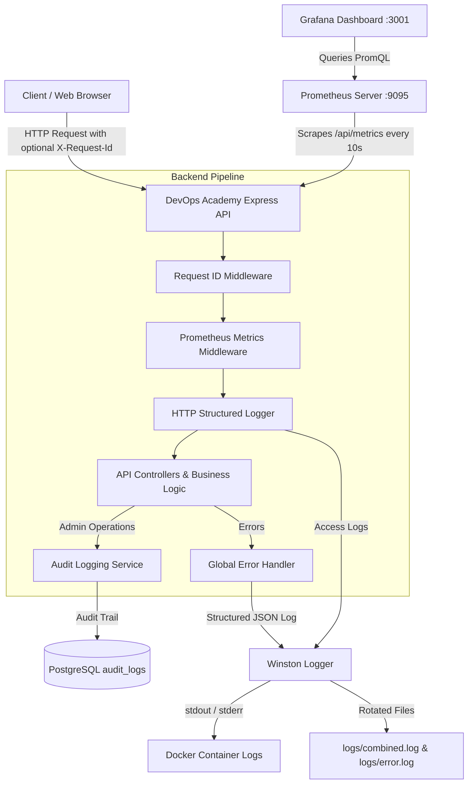

# DevOps Academy - Monitoring, Observability & Audit Logging

Comprehensive documentation for the DevOps Academy enterprise observability stack, including structured logging, distributed request tracing, administrative audit trails, Prometheus metrics, and Grafana dashboard visualization.

---

## 1. Observability Architecture



---

## 2. Structured Logging with Winston

The backend uses **Winston** configured according to 12-factor cloud principles:
- **Production (`NODE_ENV=production`)**: Outputs single-line JSON logs to `stdout` / `stderr` for ingestion by Docker, Fluentd, Vector, Datadog, or AWS CloudWatch.
- **Development (`NODE_ENV=development`)**: Outputs human-friendly colorized logs with timestamps and metadata.
- **File Rotation**: Automatically maintains local rotated log files in `./logs`:
  - `logs/error.log` (Error level only, max 10MB, 5 backups)
  - `logs/combined.log` (All levels, max 15MB, 5 backups)

### Log Levels
| Level | Severity | Use Case |
|---|---|---|
| `error` | Highest | Unhandled exceptions, 5xx responses, failed DB transactions, fatal errors |
| `warn` | High | 4xx client errors (401, 403, 404), deprecated features, retry warnings |
| `info` | Normal | Service lifecycle events, successful audit actions, server startup |
| `http` | Diagnostic | HTTP incoming request logs (method, path, status, latency) |
| `debug` | Verbose | Detailed debugging info (SQL queries, payload previews) |

### Code Usage Examples

```javascript
import { logger, createRequestLogger } from './utils/logger.js';

// Standard logging
logger.info('Database pool initialized successfully', { poolSize: 20 });
logger.error('Database connection failed', { error: err.message, stack: err.stack });

// Scoped child logger attached to request
const reqLogger = createRequestLogger(req.id, { userId: req.user?.id });
reqLogger.info('User completed lesson note update', { lessonId: 42 });
```

---

## 3. Request ID Tracing (`X-Request-Id`)

Every HTTP request is assigned a unique correlation ID by [requestId.js](file:///home/jatin-sharma/Downloads/devops-jatin-website/devops-academy/backend/src/middleware/requestId.js):

- **Auto-Generation**: If the incoming request has no `X-Request-Id` header, the server generates a unique ID:
  ```
  req-mul1a9nc-6815e58e2f74
  ```
- **Preservation & Echo**: If the client (e.g. frontend, API gateway, reverse proxy) provides an `X-Request-Id` or `X-Correlation-Id`, the backend preserves it.
- **Response Header**: The correlation ID is returned in the `X-Request-Id` HTTP response header.
- **Error Correlation**: When any 500 error occurs, the JSON error body includes the `requestId`, allowing support staff to locate the exact server log entry:
  ```json
  {
    "success": false,
    "message": "Internal server error",
    "requestId": "req-mul1a9nc-6815e58e2f74"
  }
  ```

---

## 4. Administrative Audit Logging

All administrative actions that create, modify, or delete resources are recorded in PostgreSQL `audit_logs` table via [auditService.js](file:///home/jatin-sharma/Downloads/devops-jatin-website/devops-academy/backend/src/services/auditService.js).

### Database Schema
```sql
CREATE TABLE IF NOT EXISTS audit_logs (
  id SERIAL PRIMARY KEY,
  user_id INTEGER REFERENCES users(id) ON DELETE SET NULL,
  username VARCHAR(100),
  action VARCHAR(100) NOT NULL,
  resource VARCHAR(100) NOT NULL,
  resource_id VARCHAR(100),
  details JSONB DEFAULT '{}',
  ip_address VARCHAR(50),
  user_agent VARCHAR(255),
  created_at TIMESTAMP DEFAULT CURRENT_TIMESTAMP
);
```

### Audited Admin Actions
| Action | Resource | Trigger Description |
|---|---|---|
| `ISSUE_CERTIFICATE` | `certificate` | Admin issues verified completion certificate |
| `REVOKE_CERTIFICATE` | `certificate` | Admin revokes an issued certificate |
| `UPDATE_EMAIL_SETTINGS` | `email_settings` | Admin updates SMTP or notification settings |
| `UPDATE_USER_ROLE` | `user` | Admin promotes or demotes user role |
| `DELETE_USER` | `user` | Admin deletes user account |
| `CREATE_CATEGORY` | `category` | Admin creates new curriculum category |
| `UPDATE_CATEGORY` | `category` | Admin updates existing category |
| `DELETE_CATEGORY` | `category` | Admin deletes category |
| `MODERATE_REVIEW` | `review` | Admin approves/flags student course review |
| `DELETE_REVIEW` | `review` | Admin removes course review |

### Admin Audit Logs API Endpoint

#### `GET /api/admin/audit-logs`
- **Access**: Restricted to `admin` role (`Bearer <JWT>`)
- **Query Parameters**:
  - `action`: Filter by action name (e.g. `UPDATE_EMAIL_SETTINGS`)
  - `resource`: Filter by resource type (e.g. `certificate`)
  - `userId`: Filter by admin user ID
  - `limit`: Number of items (default: 50, max: 100)
  - `offset`: Pagination offset (default: 0)

#### Response Example
```json
{
  "success": true,
  "count": 1,
  "data": [
    {
      "id": 14,
      "user_id": 1,
      "username": "Jatin_Sharma",
      "action": "UPDATE_EMAIL_SETTINGS",
      "resource": "email_settings",
      "resource_id": null,
      "details": {
        "smtpHost": "smtp.gmail.com",
        "smtpPort": 465,
        "smtpSecure": true
      },
      "ip_address": "127.0.0.1",
      "user_agent": "Mozilla/5.0 ...",
      "created_at": "2026-09-28T14:46:36.000Z"
    }
  ],
  "stats": {
    "total": 14,
    "totalAuditLogs": 14,
    "byAction": [
      { "action": "UPDATE_EMAIL_SETTINGS", "count": 6 },
      { "action": "ISSUE_CERTIFICATE", "count": 4 }
    ],
    "recentActions": [...]
  }
}
```

---

## 5. Prometheus Metrics (`/api/metrics`)

The backend exposes real-time Prometheus metrics at `/api/metrics` via `prom-client`.

### Available Metrics Catalog
| Metric Name | Type | Labels | Description |
|---|---|---|---|
| `http_requests_total` | Counter | `method`, `route`, `status_code` | Total HTTP requests handled |
| `http_request_duration_seconds` | Histogram | `method`, `route`, `status_code` | Latency distribution (buckets: 5ms to 10s) |
| `http_active_requests` | Gauge | `method` | Current in-flight requests |
| `devops_academy_entities_total` | Gauge | `entity` | Total database records (`users`, `courses`, `enrollments`, `certificates`, `quiz_attempts`, `reviews`) |
| `db_query_duration_seconds` | Histogram | `operation` | Database query duration in seconds |
| `devops_academy_process_cpu_user_seconds_total` | Counter | — | Total user CPU time spent in seconds |
| `devops_academy_nodejs_heap_size_used_bytes` | Gauge | — | Process heap memory consumed |
| `devops_academy_nodejs_eventloop_lag_seconds` | Gauge | — | Event loop latency |

### Route Normalization (Anti-Cardinality)
To prevent cardinality explosion from UUIDs, slugs, or numeric IDs in Prometheus labels, [metricsMiddleware.js](file:///home/jatin-sharma/Downloads/devops-jatin-website/devops-academy/backend/src/middleware/metricsMiddleware.js) normalizes routes:
- `/api/courses/docker-mastery` &rarr; `/api/courses/:slug`
- `/api/lessons/42/notes` &rarr; `/api/lessons/:id/notes`
- `/api/admin/reviews/9/moderate` &rarr; `/api/admin/reviews/:id/moderate`

---

## 6. Docker & Grafana Setup

The full observability stack is containerized in [docker-compose.yml](file:///home/jatin-sharma/Downloads/devops-jatin-website/devops-academy/docker-compose.yml):

### Service Endpoints
| Service | Container Name | Host Port | Internal Port | Description |
|---|---|---|---|---|
| **Backend API** | `devops_academy_backend` | `5000` | `5000` | Node.js Express REST API & Metrics |
| **PostgreSQL** | `devops_academy_db` | `5432` | `5432` | Primary Relational Database |
| **Prometheus** | `devops_academy_prometheus` | `9095` | `9090` | Time-Series Metrics Scraper & TSDB |
| **Grafana** | `devops_academy_grafana` | `3001` | `3000` | Analytics Dashboards & Alerting |

### Quickstart

1. **Start all services**:
   ```bash
   docker compose up -d
   ```

2. **Access Grafana**:
   - URL: `http://localhost:3001`
   - Default Username: `admin`
   - Default Password: `admin123` (or configured via `GRAFANA_ADMIN_PASSWORD` in `.env`)

3. **Pre-configured Dashboard**:
   The `DevOps Academy - Backend Monitoring` dashboard is automatically provisioned and loaded from [devops-academy-overview.json](file:///home/jatin-sharma/Downloads/devops-jatin-website/devops-academy/monitoring/grafana/dashboards/devops-academy-overview.json). It provides:
   - **Platform KPI Stats**: Total registered users, active courses, enrollments, certificates, and current in-flight requests.
   - **Traffic & Throughput**: Request rate (RPS) broken down by route and HTTP status codes (2xx, 3xx, 4xx, 5xx).
   - **Error Rate Gauge**: Real-time 5xx percentage calculation.
   - **Latency Percentiles**: Real-time p50, p95, and p99 response times.
   - **Node.js Health**: RSS memory, heap used vs total, CPU usage, and event loop lag.

4. **Verify Prometheus Scraping**:
   - Prometheus Web UI: `http://localhost:9095/targets`
   - Verify `devops-academy-backend` endpoint shows state `UP`.

---

## 7. Automated Testing

Run the automated monitoring test suite:
```bash
cd backend
npm run test:monitoring
```

Run all backend suites:
```bash
npm run test:all
```
All 6 suites (Auth, Email, Phase 2, Critical Fixes, Missing APIs, Monitoring) run end-to-end against live PostgreSQL.
